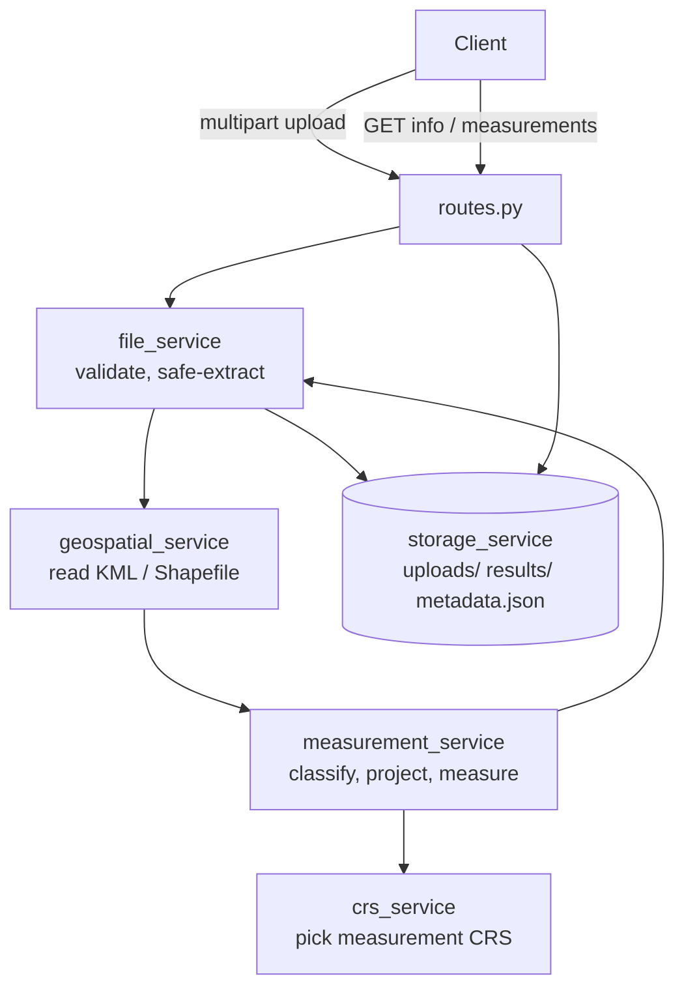

# Geospatial File Measurement API

A small FastAPI backend that accepts a **KML file** or a **zipped Shapefile**, works out the **area of every polygon** and the **length of every line** in it, and lets you read the results back over REST. Measurements are always taken in a proper projected coordinate system (or on the ellipsoid), never in raw longitude/latitude degrees.

## 1. Problem statement

Survey and GIS files usually arrive in geographic coordinates (EPSG:4326), where one unit is a degree, not a metre. Computing `polygon.area` on those numbers gives a meaningless "square degrees" figure. The task is to build an API that:

1. takes an uploaded KML or Shapefile ZIP,
2. extracts every feature with its geometry and attributes,
3. measures area (m², km²) and length (m, km) correctly by handling the CRS explicitly,
4. stores the result so it can be fetched later, even after a restart.

## 2. Objectives

- Correct measurements first: the right CRS, the right units, no invented numbers.
- Safe handling of hostile or broken input (zip tricks, oversized files, corrupt data).
- One bad feature must never sink a whole file.
- Small, readable code with a real test suite, no database and no extra infrastructure.

## 3. Features

- `POST /api/files/` for KML and `.zip` (Shapefile) uploads, with content validation and not just extension checks.
- Shapefiles can sit in nested folders inside the ZIP; macOS junk (`__MACOSX`, `.DS_Store`) is ignored.
- Per-feature status: `MEASURED`, `NOT_APPLICABLE` (points), `UNSUPPORTED`, or `FAILED`, each with a clear error code and message.
- Polygon / MultiPolygon area and LineString / MultiLineString length. GeometryCollections are measured where they contain polygons or lines. Points and MultiPoints are returned but not measured.
- Explicit CRS handling: source CRS is detected and preserved, and the CRS used for measuring is reported.
- Missing CRS is **never silently assumed** (details in section 19).
- Paginated measurements (`limit` / `offset`) with totals, so nothing is silently dropped.
- JSON file persistence with atomic writes and a lock, which survives restarts and can repair a corrupted index.
- 142 automated tests, none of which need internet or external data.

## 4. Technology stack and why

| Technology | Role | Why this choice |
|---|---|---|
| Python 3.11+ | Language | Mature geospatial ecosystem. |
| FastAPI | REST framework | Typed request/response models, automatic Swagger docs, easy testing. |
| Uvicorn | Server | Standard ASGI server for FastAPI. |
| Pydantic / pydantic-settings | Validation and config | Response schemas, persisted record schemas, and `GEO_*` environment settings. |
| GeoPandas | Reading datasets | One call reads KML and Shapefile into a table of geometries plus attributes. |
| **Pyogrio** (not Fiona) | GDAL backend | Faster, and its wheels bundle GDAL, so there is no system GDAL to install. I confirmed its KML driver is read/write capable (see section 8). |
| Shapely | Geometry | Validity checks, multi-part handling, and the transform step. |
| PyProj | CRS work | Transformations between CRSs, authority-code lookup, and ellipsoidal (geodesic) length. |
| Pytest + TestClient | Tests | Fast in-process API tests. |
| JSON files | Persistence | Assignment says no database; a JSON index plus one results file per upload is simple and inspectable. |

## 5. Architecture overview



The route layer is thin. All real work sits in services, and every failure raises a typed `AppError` that one handler turns into a consistent JSON error.

## 6. Folder structure

```
geospatial-measurement-api/
├── app/
│   ├── main.py                  # app factory, error handlers, size-limit middleware, /health
│   ├── config.py                # settings (GEO_* env vars / .env)
│   ├── api/routes.py            # the three endpoints
│   ├── models/schemas.py        # Pydantic models (stored records + API responses)
│   ├── services/
│   │   ├── file_service.py      # upload validation, safe ZIP handling, orchestration
│   │   ├── geospatial_service.py# KML / Shapefile reading
│   │   ├── crs_service.py       # measurement-CRS selection strategy
│   │   ├── measurement_service.py# classification, validation, area/length
│   │   └── storage_service.py   # atomic JSON persistence and locking
│   └── utils/exceptions.py      # typed errors with HTTP status + stable code
├── tests/                       # 142 tests (+ factories.py that builds all test data)
├── sample_data/                 # demo files + generate_samples.py
├── demo.py  sample_output.txt   # one-command demo and its saved output
├── .github/workflows/tests.yml  # CI: runs pytest on every push
├── storage/                     # created at runtime (git-ignored)
├── requirements.txt  .env.example  .gitignore  pytest.ini  README.md
```

## 7. Prerequisites

- **Python 3.11 or newer.**
- `pip`. No system GDAL, PROJ or GEOS is normally required: `pyogrio`, `pyproj` and `shapely` ship binary wheels that bundle them for Windows, macOS and Linux.
- Verified environment: **Linux, Python 3.12.3, GDAL 3.12.4 (bundled in pyogrio 0.13.0)**. I did not run the project on Windows, macOS or Python 3.11, so treat those as expected-to-work but unverified. If `pip` has to compile a geospatial package from source (unusual platforms, very old `pip`), install GDAL/PROJ/GEOS development packages first (e.g. `apt install gdal-bin libgdal-dev libproj-dev libgeos-dev` or `brew install gdal proj geos`).

## 8. Installation

```bash
cd geospatial-measurement-api

# Virtual environment
python -m venv .venv
source .venv/bin/activate          # Linux / macOS
.venv\Scripts\Activate.ps1         # Windows PowerShell
.venv\Scripts\activate.bat         # Windows cmd

# Dependencies (exact versions I tested together)
pip install --upgrade pip
pip install -r requirements.txt
```

KML support depends on the GDAL build, so check that it works in your install:

```bash
python -c "import pyogrio; print(pyogrio.list_drivers().get('KML'))"   # expect: rw
```

If this prints `None`, KML uploads will be refused with HTTP 501 (`KML_DRIVER_UNAVAILABLE`) rather than pretending to work. `GET /health` also reports `"kml_supported": true|false`.

## 9. Running the app

```bash
uvicorn app.main:app --reload
```

- API root: <http://127.0.0.1:8000> (redirects to the Swagger page)
- Swagger UI: <http://127.0.0.1:8000/docs>
- ReDoc: <http://127.0.0.1:8000/redoc>
- Health check: <http://127.0.0.1:8000/health>

Optional configuration: copy `.env.example` to `.env` (all settings are listed there, prefixed `GEO_`).

### See results without starting a server

```bash
python demo.py
```

This runs the API in-process on every file in `sample_data/` and prints a readable table of statuses, CRSs, areas, lengths and errors. A saved copy of that output is in [`sample_output.txt`](sample_output.txt), so you can see the results straight from GitHub.

Every push also runs the test suite through GitHub Actions (`.github/workflows/tests.yml`); check the repository's **Actions** tab for the result. I have not run that workflow on GitHub myself, since it only starts once the repository is pushed.

## 10. API endpoints

| Method | Path | Purpose |
|---|---|---|
| `POST` | `/api/files/` | Upload a `.kml` or `.zip`; processes it immediately. Returns `201`. |
| `GET` | `/api/files/{id}/` | File metadata, counts, CRS, status, warnings. |
| `GET` | `/api/files/{id}/measurements/?limit=&offset=` | Per-feature results, paginated. |
| `GET` | `/` | Redirects to the Swagger UI (`/docs`). |
| `GET` | `/health` | Liveness and KML-driver availability. |
| `GET` | `/` | Redirects to the Swagger docs (`/docs`). |

Processing is synchronous: when the `POST` returns, the results already exist.

## 11. Example requests and responses

**Upload (KML)**

```bash
curl -F "file=@sample_data/survey.kml" http://127.0.0.1:8000/api/files/
```

```json
{
  "id": "2577340b43f344d1a4b78b7c9a4425ae",
  "filename": "survey.kml",
  "file_type": "kml",
  "upload_timestamp": "2026-10-11T11:59:09.467329Z",
  "feature_count": 6,
  "successful_feature_count": 4,
  "failed_feature_count": 2,
  "unsupported_feature_count": 0,
  "crs": "EPSG:4326",
  "status": "PARTIAL",
  "warnings": []
}
```

`status` is `COMPLETED` (everything processed), `PARTIAL` (some features failed or are unsupported) or `FAILED` (nothing usable, e.g. no CRS). Points count as successfully processed.

**File information**

```bash
curl http://127.0.0.1:8000/api/files/2577340b43f344d1a4b78b7c9a4425ae/
```

returns the same object as the upload response.

**Measurements** (abridged; `geometry` coordinates trimmed, three of the six features shown)

```bash
curl "http://127.0.0.1:8000/api/files/2577340b43f344d1a4b78b7c9a4425ae/measurements/?limit=100&offset=0"
```

```json
{
  "file_id": "2577340b43f344d1a4b78b7c9a4425ae",
  "filename": "survey.kml",
  "status": "PARTIAL",
  "feature_count": 6,
  "successful_feature_count": 4,
  "failed_feature_count": 2,
  "unsupported_feature_count": 0,
  "source_crs": { "identifier": "EPSG:4326", "name": "WGS 84", "type": "geographic", "assumed": false },
  "measurement_crs": {
    "area":   { "method": "projected", "strategy": "utm_single_zone", "identifier": "EPSG:32643",
                "name": "WGS 84 / UTM zone 43N", "units": "metre", "description": "..." },
    "length": { "method": "projected", "strategy": "utm_single_zone", "identifier": "EPSG:32643",
                "name": "WGS 84 / UTM zone 43N", "units": "metre", "description": "..." }
  },
  "units": { "area_sq_m": "square metres", "area_sq_km": "square kilometres",
             "length_m": "metres", "length_km": "kilometres" },
  "processing_summary": {
    "by_status": { "MEASURED": 3, "NOT_APPLICABLE": 1, "FAILED": 2 },
    "by_geometry_type": { "Polygon": 2, "LineString": 1, "Point": 1, "MultiPolygon": 1, "None": 1 },
    "total_area_sq_m": 2030000.0, "total_area_sq_km": 2.03,
    "total_length_m": 3000.0, "total_length_km": 3.0
  },
  "warnings": [],
  "pagination": { "total": 6, "limit": 100, "offset": 0, "returned": 6, "has_more": false, "next_offset": null },
  "features": [
    {
      "feature_index": 0, "layer": "test", "geometry_type": "Polygon",
      "geometry": { "type": "Polygon", "coordinates": "..." },
      "source_crs": "EPSG:4326",
      "properties": { "Name": "Field A", "crop": "rice" },
      "status": "MEASURED",
      "measurements": { "area_sq_m": 2000000.0, "area_sq_km": 2.0, "length_m": null, "length_km": null },
      "errors": [], "warnings": []
    },
    {
      "feature_index": 2, "geometry_type": "Point", "status": "NOT_APPLICABLE",
      "properties": { "Name": "Well 1" },
      "measurements": { "area_sq_m": null, "area_sq_km": null, "length_m": null, "length_km": null },
      "errors": [], "warnings": []
    },
    {
      "feature_index": 4, "geometry_type": "Polygon", "status": "FAILED",
      "properties": { "Name": "Bad bowtie" },
      "measurements": { "area_sq_m": null, "area_sq_km": null, "length_m": null, "length_km": null },
      "errors": [ { "code": "INVALID_GEOMETRY", "message": "Invalid geometry: Self-intersection[77.705 11.305]" } ],
      "warnings": []
    }
  ]
}
```

Field notes:

- `geometry` is the **original** GeoJSON geometry in the file's **source CRS** (not reprojected).
- Measurements that don't apply are `null`, never `0`.
- `measurements` values are rounded for display only (area to 4 decimals in m², length to 4 in m); the full-precision numbers are what is stored.
- `layer` is the KML document/folder name, `null` for Shapefiles.

**Errors** always use one shape:

```json
{ "error": { "code": "UNSUPPORTED_FILE_TYPE", "message": "Unsupported file type. Upload a .kml file or a .zip containing a Shapefile." } }
```

| HTTP | Typical `code` values |
|---|---|
| 400 | `EMPTY_FILE`, `INVALID_KML`, `INVALID_ZIP`, `INVALID_SHAPEFILE`, `UNREADABLE_FILE`, `UNSAFE_ARCHIVE`, `ENCRYPTED_ARCHIVE` |
| 404 | `FILE_NOT_FOUND` |
| 413 | `FILE_TOO_LARGE`, `ARCHIVE_LIMIT_EXCEEDED` |
| 415 | `UNSUPPORTED_FILE_TYPE` |
| 422 | `NO_SHAPEFILE`, `MISSING_SHAPEFILE_COMPONENTS`, `MULTIPLE_SHAPEFILES`, `NO_FEATURES`, `TOO_MANY_FEATURES`, `VALIDATION_ERROR`, `INVALID_PAGINATION` |
| 500 | `INTERNAL_ERROR`, `STORAGE_ERROR`, `RESULTS_UNAVAILABLE` |
| 501 | `KML_DRIVER_UNAVAILABLE` |

Feature-level codes: `NULL_GEOMETRY`, `EMPTY_GEOMETRY`, `INVALID_GEOMETRY`, `INVALID_COORDINATES`, `UNSUPPORTED_GEOMETRY`, `CRS_MISSING`, `CRS_TRANSFORMATION_UNSUPPORTED`, `PROJECTION_FAILED`, `COORDINATES_OUT_OF_RANGE`, plus the warning `MEMBERS_IGNORED`.

## 12. Uploading KML

```bash
curl -F "file=@sample_data/survey.kml" http://127.0.0.1:8000/api/files/
```

- Must be plain KML (root element `<kml>`). **KMZ is not supported**: a KMZ renamed to `.kml` is detected and rejected with an explanation.
- KML is always WGS 84 longitude/latitude by specification, so the source CRS is `EPSG:4326`.
- `ExtendedData` values and `<name>` become `properties` (GDAL names the latter `Name`). GDAL's own empty bookkeeping fields (`tessellate`, `extrude`, ...) are dropped when unset.
- Files containing `DOCTYPE` / `ENTITY` declarations are rejected to rule out XML entity attacks.

## 13. Uploading a zipped Shapefile

```bash
curl -F "file=@sample_data/parcels_nested.zip" http://127.0.0.1:8000/api/files/
```

- Required: `.shp`, `.shx`, `.dbf`. Optional: `.prj` (without it the CRS is unknown, see section 19) and `.cpg`. Everything else in the ZIP is ignored.
- The Shapefile may sit in any sub-folder of the ZIP.
- **If a ZIP contains more than one Shapefile, it is rejected** with `MULTIPLE_SHAPEFILES` and the list of dataset names. I chose a clear error over guessing which one you meant; upload one Shapefile per ZIP.
- The headers of `.shp`, `.shx` and `.dbf` are checked, so a corrupt component gives a precise `INVALID_SHAPEFILE` error.

## 14. Units and example measurements

| Field | Unit |
|---|---|
| `area_sq_m` | square metres |
| `area_sq_km` | square kilometres (`area_sq_m / 1,000,000`) |
| `length_m` | metres |
| `length_km` | kilometres (`length_m / 1,000`) |

`sample_data/survey.kml` is built so the right answers are known: "Field A" is a 1 km × 2 km rectangle (2,000,000 m² = 2.0 km²) and "Canal" is a 3,000 m line. The API returns exactly those values. Regenerate the demo files with:

```bash
python sample_data/generate_samples.py
```

## 15. CRS approach

Every feature is first converted to WGS 84 lon/lat purely to **choose** a measurement CRS from the extent of the polygons (and separately, of the lines). Then the original geometry is transformed to that CRS and measured.

| Situation | Area | Length |
|---|---|---|
| All features inside **one UTM zone** (80°S to 84°N) | That UTM zone (EPSG:326xx north / 327xx south) | Same UTM zone |
| Spans **several zones**, extent ≤ 90° | Lambert Azimuthal Equal Area centred on the extent (exact area) | Geodesic length on the WGS 84 ellipsoid (PyProj `Geod`) |
| **Continental/global** extent | EPSG:6933 (cylindrical equal-area) | Geodesic length on WGS 84 |
| Near the poles (outside UTM limits) | Lambert Azimuthal Equal Area | Geodesic |

Why geodesic for long lines: no single projection preserves distance over several zones, so measuring on the ellipsoid is the defensible choice there.

Rules enforced:

- The source CRS is read from the file and reported unchanged (`source_crs`, and on each feature).
- The CRS actually used is reported in `measurement_crs` (`area` and `length` can differ).
- If a CRS can't be transformed, or coordinates land outside valid lon/lat after transformation, the affected features get a `FAILED` status with a specific code. The rest of the file still processes.
- Source data already in a projected CRS (e.g. Web Mercator, which inflates area by roughly 8% at this latitude) is transformed back, so the result is true ground area. There is a test for exactly that.

## 16. Storage and persistence

```
storage/
├── uploads/<id>.kml|.zip   original upload, named only by the generated id
├── results/<id>.json       {"record": ..., "features": [...]} at full precision
├── metadata.json           {"version": 1, "files": {<id>: record}}  (index)
└── tmp/                    per-request scratch, always removed
```

- Every JSON write goes to a temp file, is `fsync`ed, then `os.replace`d (atomic).
- The index is updated read-modify-write under a thread lock plus an `O_EXCL` lock file, so several worker processes can't clobber each other. A stale lock (30 s) is broken automatically. There's a test running eight separate app instances concurrently.
- Write order is original → results → index, and a failed save deletes what it wrote, so the index never points at missing data.
- Each results file embeds its file record. If `metadata.json` is missing or malformed, the index is rebuilt from `results/`, and the damaged copy is kept as `metadata.json.corrupt-<timestamp>`.
- File ids are 32 hex characters and validated against that pattern before touching the filesystem.
- No storage paths are ever returned by the API.

## 17. Error handling and security

- **Typed errors, one envelope.** Invalid input (4xx), missing resources (404), storage failures (500) and unexpected bugs (generic `INTERNAL_ERROR`) are different things. Details go to the server log; clients get a safe message with no stack traces or paths.
- **ZIP safety.** The archive is *never extracted wholesale*. Every entry is inspected (including ones that would be ignored) and rejected for `..` segments, absolute paths, Windows drive paths, backslash tricks, symlinks, encryption, and duplicate names. Only the chosen dataset's 3-5 whitelisted components are copied out, to **fixed names** (`dataset.shp`, ...) inside a private temp directory, so no archive-supplied name ever reaches the filesystem.
- **Limits** (all configurable): upload size, total uncompressed size (counted while streaming), entry count, per-member compression ratio (zip-bomb guard), and feature count. An oversized `Content-Length` is refused before the body is parsed.
- **Filenames** are reduced to a display name and never used as paths.
- **No geometry repair.** Invalid geometries are reported, not silently "fixed", because a repaired shape would give a measurement that doesn't belong to the data.

## 18. Running the tests

```bash
pytest                 # whole suite
pytest -v tests/test_crs.py
```

Last run on this code: **142 passed in ~4 s** (Linux, Python 3.12.3). Earlier in development I ran the suite several times and with the test files in reverse order, with identical results. Each test uses its own temporary storage directory, so nothing touches the real `storage/`.

Test files: `test_root`, `test_upload`, `test_file_info`, `test_measurements`, `test_crs`, `test_invalid_files`, `test_persistence`, `test_security`.

To be sure the tests can actually fail, I temporarily broke three behaviours (measuring in degrees, disabling the path-traversal check, silently assuming EPSG:4326) and confirmed that the suite caught each one.

## 19. Missing CRS

A Shapefile with no `.prj` is **accepted but not measured**. The file is stored with `status: "FAILED"`, `crs: null`, each polygon/line gets error `CRS_MISSING`, and measurements are `null`. Points are still returned. This is deliberate: guessing "probably EPSG:4326" would produce confidently wrong numbers.

To opt in explicitly, set `GEO_ASSUME_CRS_IF_MISSING=EPSG:4326` (or another CRS). Every such assumption is flagged: `source_crs.assumed` is `true` and a warning is added.

## 20. Test data

All test data is generated in code (`tests/factories.py`): KML text, Shapefiles written with GeoPandas into temporary directories, and hand-built ZIPs for the attack cases. Metric test shapes are defined in UTM 43N grid metres and converted to lon/lat, which gives exact expected values, and results are also cross-checked against an independent ellipsoidal calculation (`pyproj.Geod`) that involves no projection.

## 21. Design decisions and alternatives

- **Pyogrio over Fiona**: bundled GDAL, no compile step, faster reads. Fiona would also work.
- **Synchronous processing**: parsing is CPU-bound and fast for the supported sizes; the endpoints are plain `def`, so FastAPI runs them in a thread pool. A job queue would add infrastructure the assignment doesn't need.
- **UTM for single-zone data**: it's the standard, easily explained choice. Be aware it is conformal, not equal-area (see limitations).
- **Reject multi-Shapefile ZIPs** rather than process several datasets under one id: keeps the response model simple and the result unambiguous.
- **`201` with status `FAILED` for a file without CRS** instead of an HTTP error: the upload itself was valid, and the stored record explains exactly why nothing was measured.
- **Pydantic validates what is read back from disk**, so a hand-edited or damaged results file gives a controlled error instead of a crash.

## 22. Known limitations

- **UTM area is approximate.** Its scale factor runs from 0.9996 to about 1.001, so single-zone areas can differ from the true ellipsoidal area by up to roughly 0.2%. For example, a 1 km × 2 km site 2.7° from the zone's central meridian measures 2,000,000 m² in UTM grid metres versus about 1,997,300 m² on the ellipsoid. Multi-zone and continental data use equal-area projections and don't have this issue.
- KMZ is not supported. Every KML folder is read as a layer and all layers are flattened into one feature list (in file order); the `layer` field on each feature carries the name.
- Z values are kept in the returned geometry but ignored in measurements (planar 2D area/length).
- GeometryCollection members that aren't polygons or lines are skipped with a `MEMBERS_IGNORED` warning.
- Persistence is a flat JSON file per upload; pagination reads the whole results file. That's fine for the default 50,000-feature cap but is not built for very large datasets or high write rates.
- No authentication, rate limiting or delete endpoint, which is out of scope for this assignment.
- Tested on Linux with Python 3.12.3 only.

## 23. Learning outcomes

- Why `geometry.area` on degree coordinates is wrong, and how to pick a projection (UTM, equal-area, geodesic) based on the data's extent.
- That "equal-area" and "conformal" are different properties, and verifying a result against an independent method instead of trusting my own pipeline. (My first cross-check disagreed by 0.14%, which led me to document UTM's limits properly.)
- Defensive file handling: treating ZIPs and XML as hostile, streaming with limits, fixed extraction names.
- Designing for partial failure so one bad feature is reported, not fatal.
- Crash-safe persistence with atomic writes, locks and self-healing metadata.
- Using mutation checks to confirm tests have teeth.

## 24. Future scope

- KMZ support and multi-layer / multi-Shapefile ZIPs.
- Equal-area measurement even within a single zone (or an optional `accuracy=high` switch).
- Background jobs and a database (SQLite/PostGIS) with spatial queries for large datasets.
- GeoJSON/GeoPackage uploads, and a download endpoint for results (CSV/GeoJSON).
- Authentication, per-user quotas, and a delete endpoint.
- Configurable CRS override per upload, plus an optional geometry-repair mode that clearly labels repaired results.


